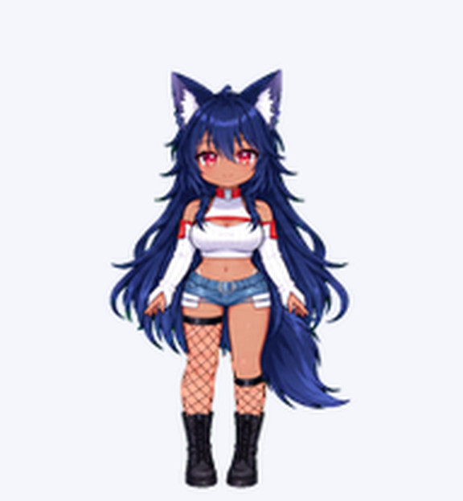
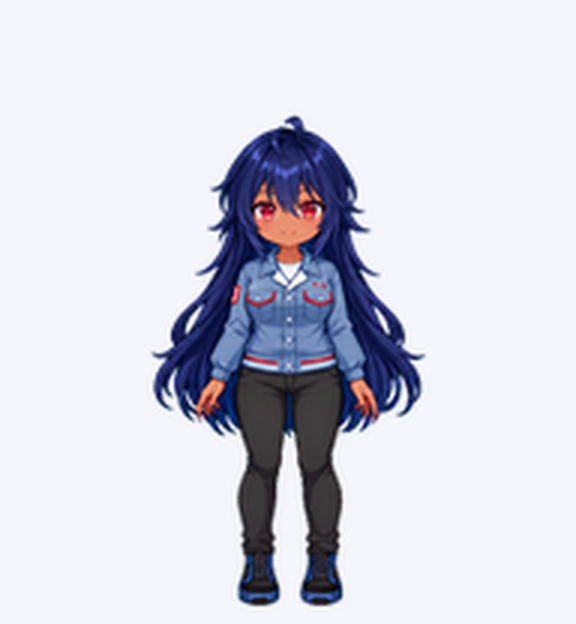
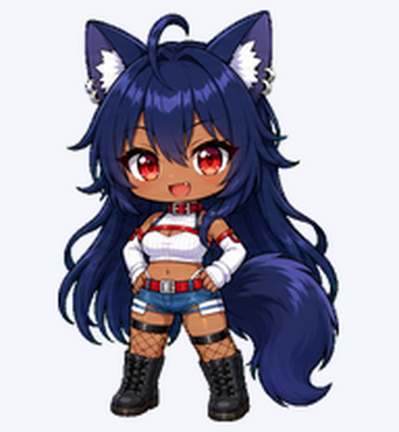

# Reia Codex Pets

ReiaのCodex Desktop用カスタムペット集です。新しい等身の **Reia（私服）** と **Reia-work（作業服）** を収録しています。以前のちびキャラ版も、旧版として残しています。

Two current Reia outfits for Codex Desktop, with the original chibi version preserved as legacy.

## 私服と作業服 / Current outfits

| Reia — 私服 / Casual | Reia-work — 作業服 / Work |
| :---: | :---: |
|  |  |
| チョーカー付き。紺色の獣耳と尻尾。 | メガネなし。青灰色の作業着と黒いパンツ。 |
| [配布ファイル / Files](reia/) · [待機アニメ / Idle](reia/idle.gif) · [全ポーズ / All poses](reia/preview.png) | [配布ファイル / Files](reia-work/) · [待機アニメ / Idle](reia-work/idle.gif) · [全ポーズ / All poses](reia-work/preview.png) |

画像はそれぞれの配布用スプライトシートから取り出した、実際の待機ポーズです。

## インストール / Install

1. このリポジトリをダウンロード、またはクローンします。
2. 下の表から使いたい版を選び、そのフォルダ内の **`pet.json` と `spritesheet.webp` の2ファイル**をインストール先へコピーします。
3. Codex Desktopのペット一覧で、対応する表示名を選びます。反映されない場合はアプリを再起動してください。

| 版 / Variant | コピー元 / Source | Windowsでのインストール先 / Destination | 表示名 / Display name |
| --- | --- | --- | --- |
| 私服・新しい等身 | [`reia/`](reia/) | `%USERPROFILE%\.codex\pets\reia\` | **Reia** |
| 作業服・新しい等身 | [`reia-work/`](reia-work/) | `%USERPROFILE%\.codex\pets\reia-work\` | **Reia-work** |
| 私服・旧ちびキャラ版 | [リポジトリ直下 / Repository root](./) | `%USERPROFILE%\.codex\pets\reia-chan\` | **レイアちゃん** |

各版のフォルダ名・IDが異なるので、3つを同時に置いて選べます。`pet.json` と `spritesheet.webp` は、必ず同じ版のものを組み合わせてください。

```text
%USERPROFILE%\.codex\pets\
├─ reia\
│  ├─ pet.json
│  └─ spritesheet.webp
├─ reia-work\
│  ├─ pet.json
│  └─ spritesheet.webp
└─ reia-chan\              # 旧版 / Legacy（任意 / optional）
   ├─ pet.json
   └─ spritesheet.webp
```

## 旧版 / Legacy

以前の等身の「レイアちゃん」です。旧版の配布データはリポジトリ直下に、内容を変更せず残しています。



[旧版の設定 / Metadata](pet.json) · [旧版スプライト / Sprite sheet](spritesheet.webp) · [旧版の全ポーズ / All poses](preview.png)

## Format

- Codex custom-pet sprite contract: v2
- Sprite sheet: transparent WebP
- Canvas: 1536 × 2288 pixels
- Grid: 8 columns × 11 rows
- Cell size: 192 × 208 pixels
- Includes standard animation states and 16 look directions

## Files

- `reia/` — current casual outfit: metadata, sprite sheet, idle animation, and contact sheet
- `reia-work/` — current work outfit: metadata, sprite sheet, idle animation, and contact sheet
- `images/` — README portraits extracted from each packaged sprite sheet
- Root `pet.json`, `spritesheet.webp`, and `preview.png` — original legacy version, preserved unchanged

## Validation

The two current sprite sheets were checked for v2 dimensions, RGBA transparency, all 73 required cells, 15 empty unused cells, chroma residue, and frame clipping. Their lossless WebP exports decode to exactly the same RGBA pixels as the approved source PNGs. Animation and look-direction QA from the original creation runs is retained locally.

Some intermediate look poses have subtle vertical cues near the horizontal axis. The four cardinal directions passed independent visual review. Desktop installation and playback of these new repository packages have not been tested in the app.

The legacy files are preserved as originally published, including their extra neutral cell.

## Credits and usage

Character concept and references were provided by the repository owner. The sprite sheet was created with AI-assisted image generation and deterministic assembly and validation in Codex.

These files are published for installation as a Codex custom pet. No broader reuse license has been declared; contact the repository owner before redistributing, modifying, or using the artwork commercially.
