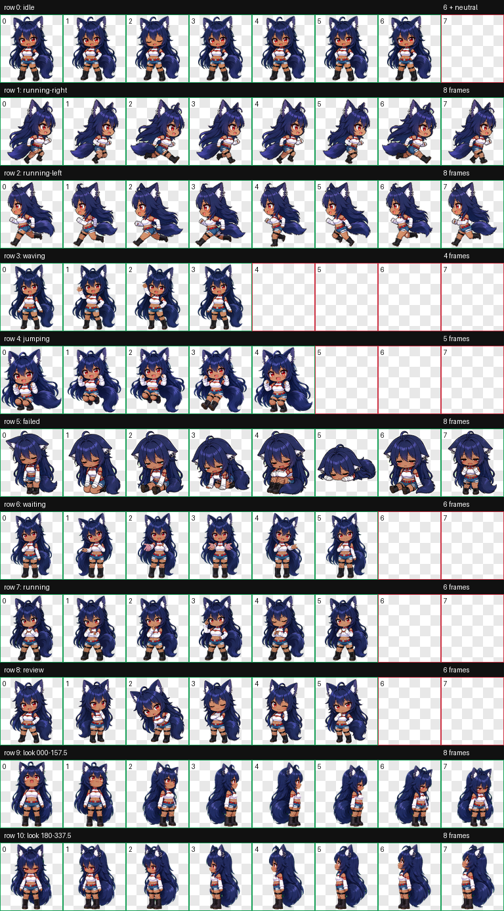

# Reia-chan Codex Pet



A chibi fox-girl custom pet for Codex Desktop, featuring a complete v2 animated sprite sheet.

## Install

1. Download or clone this repository.
2. Create `%USERPROFILE%\.codex\pets\reia-chan`.
3. Copy `pet.json` and `spritesheet.webp` from this repository into that directory.
4. In Codex Desktop, open **Settings → Pets** and refresh the pet list.
5. Select **レイアちゃん**.

The installed directory should contain exactly:

```text
%USERPROFILE%\.codex\pets\reia-chan\
├─ pet.json
└─ spritesheet.webp
```

## Format

- Codex custom-pet sprite contract: v2
- Sprite sheet: transparent WebP
- Canvas: 1536 × 2288 pixels
- Grid: 8 columns × 11 rows
- Cell size: 192 × 208 pixels
- Includes standard animation states and 16 look directions

## Files

- `pet.json` — pet metadata
- `spritesheet.webp` — production sprite sheet
- `preview.png` — animation contact-sheet preview

## Validation

The packaged sprite sheet was checked for the v2 dimensions, RGBA transparency, empty unused cells, chroma residue, frame clipping, animation continuity, and all 16 look directions.

## Credits and usage

Character concept and references were provided by the repository owner. The sprite sheet was created with AI-assisted image generation and deterministic assembly and validation in Codex.

These files are published for installation as a Codex custom pet. No broader reuse license has been declared; contact the repository owner before redistributing, modifying, or using the artwork commercially.
